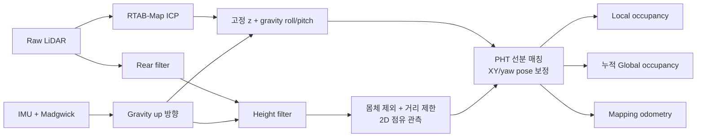
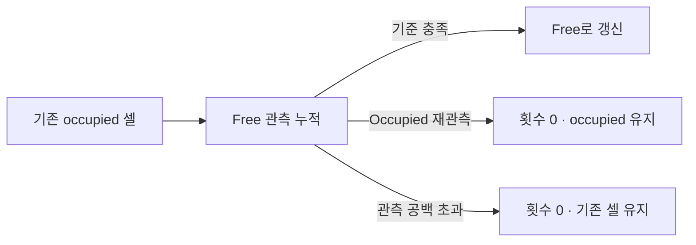
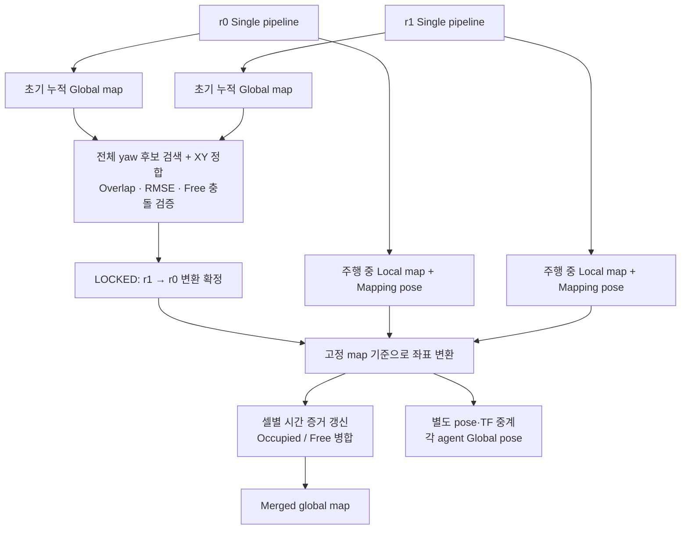
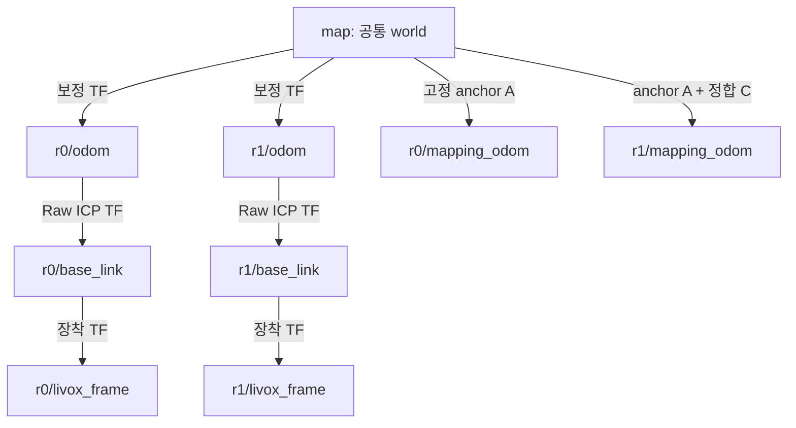

# MID-360 Single / Multi-agent 2D Mapping

- **목적:** LiDAR·IMU 기반 pose·2D occupancy map 생성, 공통 `map` 좌표계에서 두 agent 지도 병합
- **현재 브랜치:** `features/jeongeon/optimization`
- **기준 환경:** Ubuntu 22.04 / ROS 2 Humble
- **기본 동작:** raw ICP → 고정 z·IMU gravity 보정 → PHT 기반 XY/yaw 보정 → occupancy 생성
- **높이 기준:** 설정한 센서 장착 높이 사용, 바닥 plane 탐지 미사용
- **운영 전제:** 평탄한 동일 층·센서 고정 장착

- **바로가기:** [실행](#1-설치실행) · [Single](#2-single-agent-mapping) · [설정](#3-주요-파라미터) · [동적 필터](#4-동적-객체-흔적-제거) · [Multi](#5-multi-agent-mapping) · [Frame](#6-frame과-회사-시스템-연동) · [저장](#7-지도-저장과-origin) · [녹화·재생](#8-rosbag-녹화재생)

## 1. 설치·실행

### 설치

```bash
git clone --branch features/jeongeon/optimization --single-branch \
  https://github.com/Epsilon8854/co-3dto2d-mapping.git
cd co-3dto2d-mapping
bash scripts/tools/setup_environment.sh
```

- **사전 준비:** ROS 2 Humble 설치
- **센서 준비:** Livox SDK/driver 빌드·센서 IP·host IP 설정 → [설치 안내](docs/experiment_04_setup.md)
- **기존 PC 업데이트:** `git pull --ff-only` → `bash scripts/tools/setup_environment.sh --skip-install`
- **설치·빌드 터미널:** 다른 mapping workspace를 source하지 않은 새 터미널
- **명령 실행 위치:** 저장소 루트

### ▶ Single-agent: 로컬 driver + mapping + RViz

```bash
bash scripts/run_single_agent.sh --robot-id 0
```

### ▶ Multi-agent: r0 PC — 로컬 driver + mapping + 중앙 병합 + RViz

```bash
bash scripts/run_multi_agent.sh --role coordinator --robot-id 0
```

### ▶ Multi-agent: r1 PC — 로컬 driver + mapping

```bash
bash scripts/run_multi_agent.sh --role agent --robot-id 1
```

- **두 PC 공통 조건:** 동일 코드 revision·ROS domain **72**·DDS 통신 가능 네트워크·clock 동기화
- **Agent ID:** r0/r1은 논리 ID, 물리 노트북과 독립
- **Multi 초기 정합:**
  - 권장 배치: 두 센서의 전방을 같은 방향으로 정렬, 초기 yaw 차이 최소화
  - 관측 조건: 공통 벽·코너 확보, `LOCKED`까지 정지
  - 지원 범위: 서로 다른 방향의 초기 정합도 지원
- **시각화:** r0에서 RViz·초기 정합 브라우저 모니터 자동 실행
- **터미널 상태:** 입력 대기 → 관측 수집 → 검색 → 정합 완료
- **Driver 관리:** 자동 시작·종료, 동일 물리 센서의 중복 실행 차단
- **Ctrl+C:** 해당 실행기 소유 프로세스 정리

| 실행 옵션 | 용도 |
|---|---|
| `--livox-workspace /absolute/ws_livox` | 자동 탐지되지 않는 Livox workspace 지정 |
| `--driver-config /absolute/MID360_config.json` | 해당 PC·센서의 IP 설정 파일 지정 |
| `--no-start-driver` | 이미 별도로 관리하는 driver 사용 |
| `--domain-id 72` | ROS domain 선택 |
| `--robot-config FILE`, `--sensor-config FILE` | 공통 mapping / 해당 센서 설정 선택 |
| `--alignment-config FILE` | Multi 중앙 정합·병합 설정 선택 |
| `--no-rviz`, `--no-alignment-viewer` | 자동 시각화 창 생략 |
| `--dry-run` | 센서·노드 실행 없이 역할·설정 경로 확인 |

## 2. Single-agent mapping

### Workflow



- **ICP:** raw cloud 기반 이동 추정
  - 입력: 후방·높이 필터 미적용 raw cloud
  - 기본 설정: deskew OFF, 구독 queue 1
- **Gravity 보정:** IMU up 방향으로 roll/pitch 정렬, z를 설정값에 고정
  - XY/yaw: ICP 결과 전달
- **Height filter:** gravity 방향 높이 + 센서 장착 높이 → 바닥 기준 높이 환산
  - 기본 보존 구간: `0.30~1.20m`
  - 동작 조건: pose 보정 ON/OFF와 독립
- **PHT — Probabilistic Hough Transform:** 2D 점유 관측의 선분 추출·매칭
  - Target: 보정된 과거 keyframe 기본 5개 누적
  - 보정: 현재 선분 매칭 제약 + raw odometry prior → local pose graph의 XY/yaw 최적화
  - 기본 모드: `full_se2`
- **Occupancy:** 보정 pose 기반 local/global 격자 생성
  - 장애물 끝점: occupied
  - 유효 ray 통과 셀: free
  - 보정 제약: 특징·overlap 부족 시 효과 제한

### 주요 토픽

- **표기:** `N` = `0` 또는 `1`, 메시지 타입 = `패키지/msg/타입`
- **Mapping 기준 frame:** single = `rN/odom`, multi = `rN/mapping_odom`

| 토픽 | 메시지 타입 | 내용 / header frame |
|---|---|---|
| `/rN/livox/lidar` | `sensor_msgs/msg/PointCloud2` | Raw cloud · `rN/livox_frame` |
| `/rN/livox/imu` | `sensor_msgs/msg/Imu` | Raw IMU · driver 설정 frame |
| `/rN/mapping/imu_filtered` | `sensor_msgs/msg/Imu` | Madgwick orientation·IMU · `rN/livox_frame` |
| `/rN/mapping/lidar_rear_filtered` | `sensor_msgs/msg/PointCloud2` | 후방 필터 결과 · `rN/livox_frame` |
| **`/rN/mapping/plane_height_filtered`** | **`sensor_msgs/msg/PointCloud2`** | **후방 + 높이 필터 결과** · `rN/base_link` |
| `/rN/odom` | `nav_msgs/msg/Odometry` | Raw ICP pose · `rN/odom` |
| `/rN/mapping/floor_based_odometry` | `nav_msgs/msg/Odometry` | 고정 z·gravity 자세 보정 pose · mapping 기준 |
| `/rN/mapping/occupancy_mapper_odometry` | `nav_msgs/msg/Odometry` | PHT 보정까지 반영한 최종 mapping pose · mapping 기준 |
| `/rN/mapping/local_occupancy` | `nav_msgs/msg/OccupancyGrid` | 현재 관측의 local map · mapping 기준 |
| `/rN/mapping/global_occupancy` | `nav_msgs/msg/OccupancyGrid` | 해당 agent의 누적 map · mapping 기준 |
| `/rN/mapping/slice_kept_points` | `sensor_msgs/msg/PointCloud2` | 몸체·거리 제한까지 적용하고 mapping pose로 투영한 점 · mapping 기준 |
| `/rN/mapping/debug/raw_odometry_path` | `nav_msgs/msg/Path` | ICP 비교 궤적 · raw odometry 기준 |
| `/rN/mapping/debug/floor_based_odometry_path` | `nav_msgs/msg/Path` | 고정 높이·gravity 보정 궤적 · mapping 기준 |
| `/rN/mapping/debug/local_submap_corrected_odometry_path` | `nav_msgs/msg/Path` | PHT 보정 궤적 · mapping 기준 |
| `/rN/mapping/pipeline_diagnostics` | `diagnostic_msgs/msg/DiagnosticArray` | mapper 수신·처리·지연 계측 |

- **기존 토픽명 유지:** `floor_based_odometry`, `plane_height_filtered`
- **현재 처리 방식:** 고정 높이·IMU gravity 사용, LiDAR 바닥 plane 추정 미사용
- **`/plane_height_filtered`:** 후방·높이 필터 결과, 몸체 제외·거리 제한 적용 전
- **`/slice_kept_points`:** 몸체·거리 제한 적용 후 mapping pose로 투영한 최종 점군

## 3. 주요 파라미터

### 수정할 파일

| 파일 | 수정 내용 |
|---|---|
| [`config/single_agent.yaml`](config/single_agent.yaml) | 공통 높이·자세, 몸체 제외, occupancy, PHT, single 동적 필터 |
| [`config/sensors/r0.yaml`](config/sensors/r0.yaml), [`r1.yaml`](config/sensors/r1.yaml) | 센서 TF·rear filter·선택 Livox 경로 |
| [`config/multi_agent.yaml`](config/multi_agent.yaml) | `central`: 중앙 정합·병합·동적 필터, `agent_overrides`: multi에서 덮어쓸 공통 설정 |
| [`config/lidar_odometry.yaml`](config/lidar_odometry.yaml) | RTAB-Map ICP·deskew |
| [`config/dds.yaml`](config/dds.yaml) | DDS NIC·버퍼·전송 정책 |
| [`config/recording.yaml`](config/recording.yaml) | 녹화 토픽·QoS |

- **기본값 기준:** 현재 운영 YAML
- **공통 mapping 설정 위치:** `/**/ros__parameters`
- **센서 TF·rear 설정 위치:** sensor YAML
- **변경 적용:** 노드 재시작, multi 연동 변경 시 양쪽 PC 업데이트

### 높이·자세·후방·몸체 제외

| 파라미터 | 기본값 | 의미 / 변경 효과 |
|---|---|---|
| `lidar_mount_height_above_floor_m` | `0.30m` | 높이 필터용 장착 높이. 바닥 기준 환산값이 달라짐 |
| `fixed_base_link_height_above_floor_m` | `0.30m` | 보정 pose의 고정 z. 센서 높이와 별도로 설정 |
| `height_filter_enabled` | `true` | 높이 필터 ON/OFF |
| `height_filter_min_m`<br>`height_filter_max_m` | `0.30` / `1.20m` | 바닥 기준 보존 구간. min 증가 시 낮은 장애물도 제외 |
| `pose_correction_enabled` | `true` | 고정 z·gravity 자세 보정 ON/OFF. 높이 필터는 별도 |
| `gravity_filter_gain` | `0.25` | 증가하면 자세 변화에 빠르게 반응, 작으면 더 평활화 |
| `imu_timeout_sec`<br>`gravity_hold_timeout_sec` | `0.30` / `0.75s` | IMU 유효 시각차 / 마지막 gravity 유지 시간 |
| `rear_filter.enabled` | `true` | 후방 필터 ON/OFF · sensor YAML |
| `rear_filter.angle_deg`<br>`rear_filter.axis` | `120°` / `-x` | 센서 좌표계에서 제거할 전체 부채꼴 각도 / 중심 방향 |
| `sensor_tf.x/y/z` / `roll/pitch/yaw` | 모두 `0` | `base_link`에 대한 센서 장착 위치(m)·회전(rad) |
| **`robot_body_exclusion_box_size_m`** | **`1.6m`** | `base_link` 중심 XY 정사각형의 **전체 한 변**. ±0.8m 내부 점 제외. `0`이면 OFF |

- **몸체 제외 크기:** 실제 로봇 몸체·여유를 고려한 수동 설정
- **크기 증가 영향:** 가까운 실제 장애물도 지도에서 제외될 가능성
- **높이 예시:** 센서 0.30m·바닥 기준 0.30~1.20m → gravity 방향의 센서 기준 약 **0~0.90m**
- **장착 TF가 0이 아닌 경우:** 센서→몸체 좌표 변환 함께 고려

### 지도·선분 매칭

| 파라미터 | 기본값 | 의미 / 변경 효과 |
|---|---|---|
| `grid_resolution` | `0.05m` | 작을수록 세밀하며 연산·메모리 증가 |
| `local_map_size_m` | `20m` | local 정사각 격자의 한 변 |
| `range_min_m`<br>`range_max_m` | `0.8` / `12m` | occupied 끝점에 사용할 XY 거리 구간 |
| `raycast_min_range_m`<br>`raycast_max_range_m` | `0.8` / `12m` | free-space ray 처리 거리 제한 |
| `publish_period_ms` | `200ms` | local/global 지도 발행 주기. 처리·입력 속도와는 별개 |
| `local_pht_submap_pose_graph_enabled` | `true` | PHT 기반 pose 보정 활성화 |
| `local_pht_submap_pose_graph_mode` | `full_se2` | `visualization_only`: 보정 OFF / `single_line`: yaw·법선 방향 이동 / `full_se2`: 비평행 선분으로 XY/yaw 보정 |
| `local_pht_submap_history_keyframes` | `5` | target에 누적할 과거 keyframe 수. 프레임마다 무조건 추가되는 값은 아님 |
| `local_pht_submap_keyframe_translation_m`<br>`local_pht_submap_keyframe_yaw_deg` | `0.5m` / `5°` | 새 keyframe을 추가할 이동·회전 기준 |
| `local_line_pht_min_length_m` | `0.70m` | 최소 선분 길이. 증가하면 짧은 선분 제외 |
| `local_line_pht_max_gap_m` | `0.10m` | Hough 후보 추출에서 연결을 허용할 gap |
| `local_line_pht_max_contiguous_gap_m` | `0.15m` | 추출 후 선분 내부에 허용할 연속 관측 공백 |
| `local_line_pht_min_occupied_support_ratio` | `0.70` | 선분을 뒷받침하는 occupied 비율. 증가하면 더 엄격 |
| `local_pht_submap_max_angle_deg`<br>`local_pht_submap_max_normal_distance_m` | `10°` / `0.35m` | 매칭 후보의 각도·법선 거리 허용 범위 |
| `local_pht_submap_min_overlap_m` | `0.50m` | 매칭 선분의 최소 중첩 길이 |
| `local_pht_submap_weight` | `0.20` | raw odometry prior에 대한 선분 제약 가중치 |

- **Hough vote threshold:** C++ 추출 설정값, 운영 YAML 미노출
- **Deskew 기본값:** `config/lidar_odometry.yaml`의 `deskewing: false`
- **ICP queue 기본값:** 공용 launch에서 `1` 지정

## 4. 동적 객체 흔적 제거

- **방식:** 기존 occupied 셀의 반복 free 관측 → 동적 객체 흔적 제거
- **현재 기본:** single 내부 필터 **OFF**, multi 중앙 필터 **ON**
- **중앙 입력:** 양쪽 agent의 local 관측 통합



| Single: `single_agent.yaml` | Multi: `multi_agent.yaml`의 `central` | 기본값 / 효과 |
|---|---|---|
| `dynamic_filter_enabled` | `merged_dynamic_filter_enabled` | `false` / `true` |
| `dynamic_free_clear_count` | `merged_dynamic_free_clear_count` | `30` · 증가하면 삭제가 보수적이며 흔적이 오래 유지 |
| `dynamic_evidence_timeout_sec` | `merged_dynamic_evidence_timeout_sec` | `5s` · 관측 공백 후 연속 free 횟수 초기화 |
| `dynamic_clear_max_range_m` | `merged_dynamic_clear_max_range_m` | `6m` · 기존 occupied 삭제를 허용할 관측 거리 |
| 해당 없음 | `merged_dynamic_observation_bin_sec` | `0.1s` · 같은 셀·시간 bin에서 두 agent를 합쳐 free 최대 1회 인정 |

- **Unknown·미관측:** free 증거로 미사용
- **Timeout:** free 연속 횟수만 초기화, 기존 occupied 유지
- **시간 처리:** 원 관측 timestamp 사용, 중복·과거 관측 검사
- **동일 bin의 occupied/free 충돌:** occupied 우선
- **삭제 소요시간:** 유효 관측률·가림·occupied 재관측에 따라 변동
- **`30회`:** 시간 기준이 아닌 유효 free 관측 횟수
- **정적 장애물 보존 조절:** clear count 증가·clear 거리 축소 검토
- **잔류 흔적 확인:** 중간 셀별 유효 free 관측 누적 여부 확인, 먼 hit 존재만으로 삭제 판단 불가

## 5. Multi-agent mapping

### Workflow와 교환 정보



- **초기 정합:**
  - 입력: 정지 상태에서 누적한 두 global map
  - 검색: 전체 yaw + XY 변환
  - 확정 조건: overlap·오차·occupied/free 충돌·후보 구분 기준 통과
- **주행 중 병합:**
  - 초기 global map 구독 해제 → local map·mapping pose·session 수신
  - r1 기준 점유 좌표 → 중앙에서 공통 `map` 좌표로 변환
- **통신:** 중앙 병합·pose 중계의 원격 raw cloud/IMU 구독 없음
  - rqt·녹화기의 원격 raw 토픽 추가 구독 시 별도 전송 비용 발생
- **프로세스 분리:** pose/TF 중계 ↔ 지도 정합·누적·경로·파일 저장
- **주기 정합:** 기본 OFF, `central.periodic.enabled: true`로 활성화
  - 비교 대상: r1 최근 누적 submap ↔ r0 과거 누적 지도 영역
  - 채택 결과: r1→r0 변환 갱신·기존 관측 재투영
  - 기준 유지: r0 pose·고정 world anchor
  - [상세 동작](docs/experiment_04_periodic_alignment.md)

### 주요 공개 토픽

| 토픽 | 메시지 타입 | 내용 / 기준 |
|---|---|---|
| **`/multi_agent/merged_global_occupancy`** | `nav_msgs/msg/OccupancyGrid` | **최종 병합 지도 · `map`** |
| `/multi_agent/r1/aligned_global_occupancy` | `nav_msgs/msg/OccupancyGrid` | 공통 좌표로 변환·누적한 r1 layer · `map` |
| **`/multi_agent/rN/global_pose`** | `geometry_msgs/msg/PoseWithCovarianceStamped` | **각 agent의 전역 pose · `map`** |
| `/multi_agent/rN/aligned_odometry` | `nav_msgs/msg/Odometry` | 전역 pose와 기존 body 속도 추정 · `map`, child=`rN/base_link` |
| `/multi_agent/rN/aligned_path`, `/multi_agent/rN/raw_path` | `nav_msgs/msg/Path` | 최종 보정 / raw 비교 궤적 · `map` |
| `/multi_agent/r1_to_r0_transform` | `geometry_msgs/msg/TransformStamped` | `r0/mapping_odom ← r1/mapping_odom` 변환 |
| `/multi_agent/map_anchor` | `geometry_msgs/msg/TransformStamped` | 고정 `map ← r0/mapping_odom` 변환 |
| `/multi_agent/alignment_ready` | `std_msgs/msg/Bool` | 초기 정합 완료 여부 |
| `/multi_agent/alignment_status` | `diagnostic_msgs/msg/DiagnosticArray` | 정합 단계·후보·입력 지연·변환 정보 |
| `/multi_agent/map_status` | `diagnostic_msgs/msg/DiagnosticArray` | 지도 ready·revision·coordinate epoch |
| `/multi_agent/pose_relay_status` | `diagnostic_msgs/msg/DiagnosticArray` | 전역 pose 발행·TF 대기·지연 상태 |
| `/multi_agent/rN/session` | `diagnostic_msgs/msg/DiagnosticArray` | agent 재시작·입력 reset 식별 |

### 초기 정합·병합 설정

- **설정 위치:** `config/multi_agent.yaml`의 `central`

| 파라미터 | 기본값 | 의미 / 변경 효과 |
|---|---|---|
| `startup_accumulation_sec` | `3s` | 초기 누적 지도 수집 기준. 전체 정합 소요시간을 보장하지 않음 |
| `confirmation_windows` | `1` | 채택 후보 확인 횟수. 증가하면 시간적 일관성 검증 강화 |
| `search.coarse_yaw_step_deg` | `5°` | 전체 yaw 후보 간격. 작을수록 탐색량 증가 |
| `registration.coarse_translation_range_m` | `2.5m` | 초기 XY 검색 범위 |
| `registration.min_symmetric_overlap` | `0.30` | 최소 양방향 중첩 비율. 증가하면 엄격 |
| `registration.max_symmetric_rmse_m` | `0.25m` | 정합 RMSE 상한. 감소하면 엄격 |
| `registration.max_free_conflict_ratio` | `0.18` | 비교 가능한 occupied/free 모순 비율 상한. 성공 확률을 뜻하지 않음 |
| `submap_radius_m` | `12m` | 초기 정합용 입력 patch 반경 |
| `output_resolution_m`<br>`merged_period_sec` | `0.05m` / `0.5s` | 병합 격자 해상도 / 처리 스케줄 기준 간격 |
| `local_queue_size` | `100` | 중앙 local map 대기열. 연산 자체를 빠르게 하지는 않음 |
| `periodic.enabled` | `false` | 초기 정합 이후 주기적 inter-agent 정합·재투영 활성화 |

## 6. Frame과 회사 시스템 연동

| Frame | 역할 |
|---|---|
| **`map`** | Multi 공통 고정 world. 중앙이 처음 수신한 r0 mapping pose의 **XY·yaw**를 기준으로 원점·방향 설정 |
| `rN/odom` | RTAB-Map raw ICP odometry의 로컬 기준 |
| `rN/mapping_odom` | Multi에서 고정 높이·gravity·PHT mapping pose와 지도의 내부 기준 |
| `rN/base_link` | 로봇 몸체 좌표계 |
| `rN/livox_frame` | 몸체에 고정된 LiDAR 좌표계 |



- **고정 anchor:** $A = {}^{map}T_{r0/mapping\_odom}$, 최초 r0 XY/yaw 기준
- **Agent 간 정합:** $C = {}^{r0/mapping\_odom}T_{r1/mapping\_odom}$
- **전역 pose:** $P_{0,global}=A P_0$, $P_{1,global}=A C P_1$
- **초기 기준:** XY/yaw = 0, base z = 바닥 기준 설정 높이 0.30m
- **TF 소유자:** raw `odom→base_link`는 ICP, 보정 `map→odom`은 중앙 relay
- **보정 계산:** 동일 source timestamp의 두 pose 사용

$$
T_{map\leftarrow odom}(t)=T_{map\leftarrow base,\ corrected}(t)\,T_{odom\leftarrow base,\ raw}(t)^{-1}
$$

- **회사 측 연동:** goal·global path·현재 global pose를 모두 `map` 기준으로 통일
- **보정 시 변화:** `map` 원점 유지, 로봇 pose·지도 관측 위치 갱신
- **주행/exploration 시스템 역할:** 지도 변경 후 goal 도달 가능성 검토·경로 재계획·frontier 재선택
- **본 저장소 역할:** 지도·pose 제공, goal 자동 변경 없음
- **좌표 유효성 재확인:** `map_status.coordinate_epoch` 변경 시 기존 goal/path 검토
- **새 기준 가능 조건:** 중앙 재시작·r0 session reset
- **RViz Fixed Frame:** single = `rN/odom`, multi = `map`
- **Multi 전역 TF·pose 발행 조건:** 초기 정합 완료·동일 시각 raw TF 확보

## 7. 지도 저장과 Origin

### 저장 위치·형태

- **Merged map 저장 PC:** 중앙 r0
- **초기 정합 미완료 시:** agent별 미정합 지도만 저장

```text
outputs/
├── single_agent/runs/20261026_143025/
│   ├── configs/                         # 원본·최종 적용 YAML, DDS 설정
│   ├── run.yaml                         # 실행 시각·인자·Git revision
│   └── cycle_001/maps/global_map.*
└── multi_agent/runs/20261026_143025/
    ├── configs/
    ├── run.yaml
    └── cycle_001/
        ├── maps/
        │   ├── merged_global_map.pgm
        │   ├── merged_global_map.yaml
        │   ├── merged_global_map.png
        │   ├── merged_global_map_with_paths.png
        │   ├── merged_global_map_data.npz
        │   ├── r0_global_map.*
        │   └── r1_aligned_global_map.*
        ├── checkpoint/                  # 기본 10초 간격의 중간 저장
        ├── alignment/                   # r1→r0 변환
        └── save_status.json             # world anchor·epoch·revision·저장 상태
```

- **실행 폴더명:** 한국 시각 `YYYYMMDD_HHMMSS`
- **`cycle_001`:** 첫 처리 회차, 주행 바퀴 수와 무관
- **반복 재생:** `cycle_002`, `cycle_003`, …으로 구분
- **식별명 지정:** `--run-id 20261026_143025_airoom`
- **실험별 저장 위치:** `--output-root outputs/experiment_NAME`
- **파일 용도:** PNG = 검토, PGM+YAML = map server, NPZ = 원 격자·좌표·timestamp 분석
- **Git 제외:** `outputs/`·bag·빌드 결과
- **최종 저장:** 정상 Ctrl+C 종료 시
- **중간 저장:** 중앙 지도 checkpoint 기본 10초 간격
- **수동 저장:** 탐사 완료 등 원하는 시점에 아래 서비스 호출

```bash
bash scripts/tools/with_dds.sh ros2 service call \
  /multi_agent/save_map std_srvs/srv/Trigger '{}'
```

### map 원점과 YAML origin의 차이

- **`map` 원점:** 세션 공통의 고정 좌표 기준
- **YAML `origin: [x, y, yaw]`:** `map` 기준 저장 격자 좌하단의 위치·회전
  - `map` 원점과 별개, 음수 좌표도 정상
- **`resolution`:** 한 셀의 폭(m)
- **셀 중심 계산:** 열 `c`·아래에서부터 행 `r` 기준, 아래 수식 적용
- **이미지 행 번호:** 위에서부터 증가하므로 좌표 계산 시 상하 반전

$$
p_{map}=\begin{bmatrix}x_0\\y_0\end{bmatrix}+R(\theta_0)\,resolution\begin{bmatrix}c+0.5\\r+0.5\end{bmatrix}
$$

- **Occupancy 값:** unknown=`-1`, free=`0`, occupied=`100`
- **회사 측 map server frame:** `map`
- **지도 확장:** YAML `origin` 변경 가능, 세션의 고정 `map` 기준 유지

## 8. Rosbag 녹화·재생

### 녹화: 중앙 r0 PC 한 곳에서 두 agent 저장

```bash
# 기본: 후방·높이 필터 cloud, pose, TF, 정합 상태
bash scripts/tools/record_bag.sh --name airoom_dynamic

# 중앙 정합·동적 필터를 동일 local 입력으로 재현하려면 지도도 포함
bash scripts/tools/record_bag.sh --name airoom_dynamic --with-agent-maps

# ICP·IMU·높이 필터부터 다시 계산하려면 raw 포함 (원격 통신 증가)
bash scripts/tools/record_bag.sh --name airoom_raw --include-raw --with-agent-maps

# Single 녹화
bash scripts/tools/record_bag.sh --pipeline single --robot-id 0 --name hallway --include-raw
```

- **녹화 범위:** 토픽 저장만 수행, mapping/driver는 별도 실행·종료
- **Multi bag 위치:** `outputs/multi_agent/captures/NAME_YYYYMMDD_HHMMSS/bag/`
- **Single bag 위치:** `outputs/single_agent/captures/NAME_YYYYMMDD_HHMMSS/bag/`
- **설정·취득 metadata:** `bag/` 상위 폴더
- **기본 bag:** filtered cloud·기록 pose 포함, raw LiDAR/IMU 미포함
- **재처리 범위:**
  - Filtered cloud + 기록 pose → mapper 후처리
  - Local map 추가 기록 → 중앙 병합 재현
  - `--include-raw` 추가 → ICP·IMU·높이 필터부터 재계산

### 재생: raw LiDAR/IMU를 포함한 bag

```bash
# URI는 metadata.yaml을 포함하는 bag 디렉터리
bash scripts/tools/replay_bag.sh --pipeline single --robot-id 0 \
  --bag /absolute/capture/bag --loop

bash scripts/tools/replay_bag.sh --pipeline multi \
  --bag /absolute/combined_capture/bag --loop
```

- **Multi raw 재생 입력:** 두 agent의 raw LiDAR·IMU·센서 TF
- **재생 속도:** `--rate 0.5` → 절반 속도
- **반복 여부:** `--loop` 지정 시 반복, 생략 시 1회
- **재생 환경:** 같은 domain의 실센서·다른 player 종료 또는 `--domain-id`로 분리
- **시간·상태:** 단일 clock 사용, 회차마다 노드 재시작·상태 초기화
- **별도 RViz/rqt/CLI:** 동일 DDS 환경 사용 → `bash scripts/tools/with_dds.sh rqt`

## 9. 저장소 구조·상세 문서

| 경로 | 용도 |
|---|---|
| `co_3dto2d_mapping/common/` | 공통 좌표 변환·격자·저장 |
| `co_3dto2d_mapping/single_agent/` | 높이·gravity·rear 필터, single 저장 |
| `co_3dto2d_mapping/multi_agent/` | 정합·중앙 병합·pose/TF 중계 |
| `include/`, `src/` | 현재 occupancy/PHT C++ mapper |
| `scripts/run_single_agent.sh`, `scripts/run_multi_agent.sh` | 공용 실시간 실행기 |
| `scripts/tools/`, `scripts/lib/` | 설치·녹화·재생·진단 / 실행·DDS·driver 내부 처리 |
| `rviz/single_agent.rviz`, `rviz/multi_agent.rviz` | 운영 RViz 설정 |
| `scripts/experiment/`, `config/experiment/` | 과거 실험 재현 코드·설정. 운영 기본값과 구분 |

- [운영 명령·구조](docs/workspace_layout.md) · [Livox·두 PC 설치](docs/experiment_04_setup.md) · [DDS 설정](docs/experiment_04_dds_network.md) · [주기 정합·재투영](docs/experiment_04_periodic_alignment.md)
