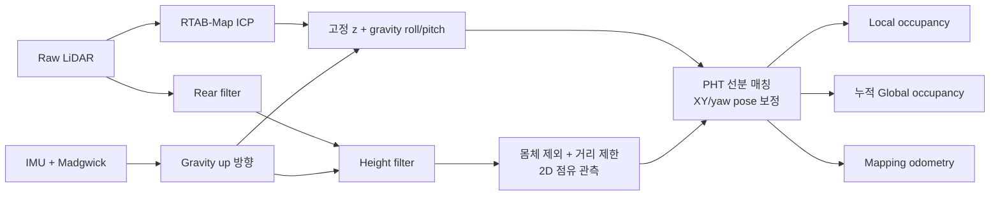
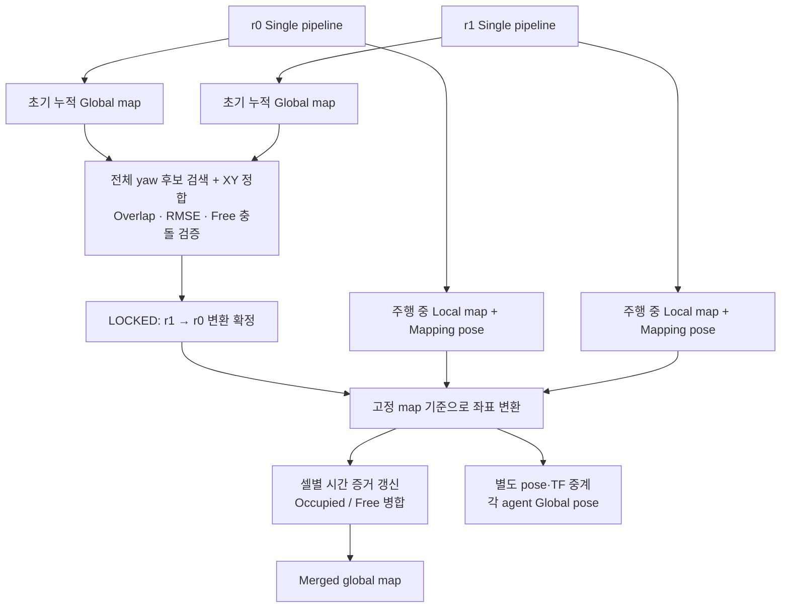

# MID-360 Single / Multi-agent 2D Mapping

- **기능:** LiDAR·IMU 기반 pose 추정 · 2D occupancy 생성 · 두 agent 지도 병합
- **운영 전제:** 평탄한 동일 층 · 센서 고정 장착

## 1. 초기 환경 설정

- **환경:** Ubuntu 22.04 · ROS 2 Humble
- **준비:** Livox SDK·driver 설치 및 센서 IP 설정 → [설치 안내](docs/experiment_04_setup.md)
- **설치 터미널:** 다른 mapping workspace를 source하지 않은 새 터미널

```bash
git clone --branch features/jeongeon/optimization --single-branch \
  https://github.com/Epsilon8854/co-3dto2d-mapping.git
cd co-3dto2d-mapping
bash scripts/tools/setup_environment.sh
```

- **업데이트:** `git pull --ff-only` → `bash scripts/tools/setup_environment.sh --skip-install`
- **실행 위치:** 저장소 루트
- **센서별 설정:** `config/sensors/r0.yaml`·`r1.yaml`의 `livox.workspace`·`livox.config_file`·장착 TF 수정
- **두 PC:** 동일 코드 · ROS domain 72 · DDS 통신 가능한 네트워크 · clock 동기화

## 2. Single-agent mapping

### 2.1 Workflow



- **ICP:** raw cloud 기반 이동 추정
  - 입력: 후방·높이 필터 미적용 raw cloud
  - 기본 설정: deskew OFF, 구독 queue 1
- **Gravity 보정:** IMU up 방향으로 roll/pitch 정렬, z를 설정값에 고정
  - XY/yaw: ICP 결과 전달
- **Height filter:** gravity 방향 높이 + 센서 장착 높이 → 바닥 기준 높이 환산
  - 기본 보존 구간: `0.30~1.20m`
  - 동작 조건: pose 보정 ON/OFF와 독립
- **PHT — Probabilistic Hough Transform:** 2D 점유 관측의 선분 추출·매칭
  - Target: 보정된 과거 keyframe 기본 5개 누적
  - 보정: 현재 선분 매칭 제약 + raw odometry prior → local pose graph의 XY/yaw 최적화
  - 기본 모드: `full_se2`
- **Occupancy:** 보정 pose 기반 local/global 격자 생성
  - 장애물 끝점: occupied
  - 유효 ray 통과 셀: free
  - 보정 제약: 특징·overlap 부족 시 효과 제한

### 2.2 실행

```bash
bash scripts/run_single_agent.sh --robot-id 0
```

- **자동 실행:** driver · mapping · RViz
- **RViz Fixed Frame:** `map` · 첫 유효 odometry의 XY·yaw를 기준으로 원점 고정
- **TF:** `map → r0/odom → r0/base_link → r0/livox_frame`
- **지도·보정 pose:** `map` 기준 · Raw ICP는 `r0/odom` 기준 유지
- **저장:** 정상 Ctrl+C 종료 시 최종 지도 한 번 저장 · 실행 중 주기 저장 없음
- **종료:** Ctrl+C · 소유 driver 종료

### 2.3 주요 토픽

- **표기:** `N` = `0` 또는 `1`, 메시지 타입 = `패키지/msg/타입`
- **Mapping 기준 frame:** single = `map`, multi = `rN/mapping_odom`

| 토픽 | 메시지 타입 | 내용 / header frame |
|---|---|---|
| `/rN/livox/lidar` | `sensor_msgs/msg/PointCloud2` | Raw cloud · `rN/livox_frame` |
| `/rN/livox/imu` | `sensor_msgs/msg/Imu` | Raw IMU · driver 설정 frame |
| **`/rN/mapping/plane_height_filtered`** | **`sensor_msgs/msg/PointCloud2`** | **후방 + 높이 필터 결과** · `rN/base_link` |
| `/rN/odom` | `nav_msgs/msg/Odometry` | Raw ICP pose · `rN/odom` |
| `/rN/mapping/floor_based_odometry` | `nav_msgs/msg/Odometry` | 고정 z·gravity 자세 보정 pose · mapping 기준 |
| `/rN/mapping/occupancy_mapper_odometry` | `nav_msgs/msg/Odometry` | PHT 보정까지 반영한 최종 mapping pose · mapping 기준 |
| `/rN/mapping/local_occupancy` | `nav_msgs/msg/OccupancyGrid` | 현재 관측의 local map · mapping 기준 |
| `/rN/mapping/global_occupancy` | `nav_msgs/msg/OccupancyGrid` | 해당 agent의 누적 map · mapping 기준 |
| `/rN/mapping/slice_kept_points` | `sensor_msgs/msg/PointCloud2` | 몸체·거리 제한까지 적용하고 mapping pose로 투영한 점 · mapping 기준 |

### 2.4 주요 파라미터

- **공통 mapping:** `config/single_agent.yaml`의 `/**/ros__parameters`
- **센서 TF·후방 필터:** `config/sensors/rN.yaml`
- **ICP:** `config/lidar_odometry.yaml` · raw cloud 입력 · deskew OFF · queue 1
- **적용:** 설정 변경 후 재시작

#### 높이·자세·후방·몸체 제외

| 파라미터 | 기본값 | 의미 / 변경 효과 |
|---|---|---|
| `lidar_mount_height_above_floor_m` | `0.30m` | 높이 필터용 장착 높이<br>변경 시 바닥 기준 환산값 변경 |
| `fixed_base_link_height_above_floor_m` | `0.30m` | 보정 pose의 고정 z<br>센서 높이와 별도 설정 |
| `height_filter_enabled` | `true` | 높이 필터 ON/OFF |
| `height_filter_min_m`<br>`height_filter_max_m` | `0.30` / `1.20m` | 바닥 기준 보존 구간<br>min 증가 시 낮은 장애물도 제외 |
| `pose_correction_enabled` | `true` | 고정 z·gravity 자세 보정 ON/OFF<br>높이 필터와 독립 |
| `rear_filter.enabled` | `true` | 후방 필터 ON/OFF · sensor YAML |
| `rear_filter.angle_deg`<br>`rear_filter.axis` | `120°` / `-x` | 센서 좌표계에서 제거할 전체 부채꼴 각도 / 중심 방향 |
| `sensor_tf.x/y/z` / `roll/pitch/yaw` | 모두 `0` | `base_link`에 대한 센서 장착 위치(m)·회전(rad) |
| **`robot_body_exclusion_box_size_m`** | **`1.6m`** | `base_link` 중심 XY 정사각형의 **전체 한 변**<br>±0.8m 내부 점 제외 · `0`이면 OFF |

- **높이 예시:** 센서 0.30m · 바닥 기준 0.30~1.20m → 센서 기준 약 0~0.90m
- **몸체 제외:** `base_link` 중심 XY 정사각형 · 실제 몸체 크기·여유에 맞게 설정

#### 지도·PHT 선분 매칭

| 파라미터 | 기본값 | 의미 / 변경 효과 |
|---|---|---|
| `grid_resolution` | `0.05m` | 작을수록 세밀하며 연산·메모리 증가 |
| `local_map_size_m` | `20m` | local 정사각 격자의 한 변 |
| `range_min_m`<br>`range_max_m` | `0.8` / `12m` | occupied 끝점에 사용할 XY 거리 구간 |
| `raycast_min_range_m`<br>`raycast_max_range_m` | `0.8` / `12m` | free-space ray 처리 거리 제한 |
| `publish_period_ms` | `200ms` | local/global 지도 발행 주기<br>처리·입력 속도와 별개 |
| `local_pht_submap_pose_graph_enabled` | `true` | PHT 기반 pose 보정 활성화 |
| `local_pht_submap_history_keyframes` | `5` | target에 누적할 과거 keyframe 수<br>프레임마다 무조건 추가되는 값은 아님 |
| `local_line_pht_min_length_m` | `0.70m` | 최소 선분 길이<br>증가 시 짧은 선분 제외 |

#### 동적 객체 흔적 제거

- **방식:** occupied 셀의 free 관측 누적 → 기준 충족 시 free로 갱신
- **Occupied 재관측:** free 횟수 초기화 · occupied 유지
- **Unknown·관측 공백:** 기존 occupied 유지

| 파라미터 | 기본값 | 의미 |
|---|---|---|
| `dynamic_filter_enabled` | `true` | 동적 흔적 제거 ON/OFF |
| `dynamic_free_clear_count` | `30` | 삭제에 필요한 free 관측 횟수 · 증가 시 보수적 |
| `dynamic_evidence_timeout_sec` | `5s` | 관측 공백 초과 시 free 횟수만 초기화 |
| `dynamic_clear_max_range_m` | `10m` | occupied 삭제 증거로 사용할 관측 거리 |

## 3. Multi-agent mapping

### 3.1 Workflow



- **초기 정합:**
  - 입력: 정지 상태에서 누적한 두 global map
  - 검색: 전체 yaw + XY 변환
  - 확정 조건: overlap·오차·occupied/free 충돌·후보 구분 기준 통과
- **주행 중 병합:**
  - 초기 global map 구독 해제 → local map·mapping pose·session 수신
  - r1 기준 점유 좌표 → 중앙에서 공통 `map` 좌표로 변환
- **통신:** 중앙 병합·pose 중계의 원격 raw cloud/IMU 구독 없음
### 3.2 실행

```bash
# 중앙 r0 PC
bash scripts/run_multi_agent.sh --robot-id 0

# r1 PC
bash scripts/run_multi_agent.sh --robot-id 1
```

- **역할:** ID 0 = 중앙 병합 포함 · ID 1 = agent mapping
- **초기 배치:** 가급적 두 센서의 전방을 같은 방향으로 정렬 · 초기 yaw 차이 최소화
- **정합 대기:** 공통 벽·코너 관측 · `LOCKED`까지 정지
- **시각화:** r0에서 RViz·정합 모니터 자동 실행 · Fixed Frame = `map`
  - 원점: 큰 XYZ 축·`MAP WORLD ORIGIN` 표식
  - 전역 pose: 원점 근처 r0(주황)·r1(청록) 수치 패널 · XYZ(m)·roll/pitch/yaw(°)
  - 수신 공백 2초 초과 시 회색 `STALE` 표시
  - 표시 토픽: `/multi_agent/visualization_markers`
- **종료:** r1 먼저 종료 → r0 종료 · 중앙에서 최종 merged map 저장

### 3.3 주요 토픽

| 토픽 | 메시지 타입 | 내용 / 기준 |
|---|---|---|
| **`/multi_agent/merged_global_occupancy`** | `nav_msgs/msg/OccupancyGrid` | **최종 병합 지도 · `map`** |
| **`/multi_agent/rN/global_pose`** | `geometry_msgs/msg/PoseWithCovarianceStamped` | **각 agent의 전역 pose · `map`** |
| `/multi_agent/rN/aligned_odometry` | `nav_msgs/msg/Odometry` | 전역 pose와 기존 body 속도 추정 · `map`, child=`rN/base_link` |
| `/multi_agent/rN/aligned_path`, `/multi_agent/rN/raw_path` | `nav_msgs/msg/Path` | 최종 보정 / raw 비교 궤적 · `map` |
| `/multi_agent/alignment_ready` | `std_msgs/msg/Bool` | 초기 정합 완료 여부 |
| `/multi_agent/alignment_status` | `diagnostic_msgs/msg/DiagnosticArray` | 정합 단계·후보·입력 지연·변환 정보 |
| `/multi_agent/map_status` | `diagnostic_msgs/msg/DiagnosticArray` | 지도 ready·revision·coordinate epoch |

### 3.4 주요 파라미터

- **설정:** `config/multi_agent.yaml`의 `central`
- **Agent mapping:** Single 설정 상속 · 차이는 `agent_overrides`에서 지정

| 파라미터 | 기본값 | 의미 / 변경 효과 |
|---|---|---|
| `startup_accumulation_sec` | `3s` | 초기 누적 지도 수집 기준 |
| `confirmation_windows` | `1` | 후보 확인 횟수 · 증가 시 일관성 검증 강화 |
| `registration.min_symmetric_overlap` | `0.30` | 최소 양방향 중첩 비율 · 증가 시 엄격 |
| `registration.max_symmetric_rmse_m` | `0.25m` | 정합 RMSE 상한 · 감소 시 엄격 |
| `registration.max_free_conflict_ratio` | `0.20` | 비교 가능한 occupied/free 모순 비율 상한 |
| `output_resolution_m`<br>`merged_period_sec` | `0.05m` / `0.5s` | 병합 격자 해상도 / 처리 스케줄 기준 간격 |
| `periodic.enabled` | `false` | 초기 정합 이후 주기적 inter-agent 정합·재투영 활성화 |

| 중앙 동적 필터 파라미터 | 기본값 | 의미 |
|---|---|---|
| `merged_dynamic_filter_enabled` | `true` | 중앙 동적 흔적 제거 |
| `merged_dynamic_free_clear_count` | `30` | 셀 삭제에 필요한 free 관측 횟수 |
| `merged_dynamic_evidence_timeout_sec` | `5s` | 관측 공백 시 free 횟수 초기화 |
| `merged_dynamic_clear_max_range_m` | `10m` | 삭제 증거로 사용할 관측 거리 |
| `merged_dynamic_observation_bin_sec` | `0.1s` | 같은 셀·시간 구간의 중복 free 집계 방지 |

- **동일 구간 충돌:** occupied 우선 · 두 agent의 free는 한 번만 집계
- **주기 정합:** 기본 OFF · 활성화 시 r1→r0 변환 갱신 및 기존 관측 재투영 → [상세](docs/experiment_04_periodic_alignment.md)

#### 좌표계

| Frame | 역할 |
|---|---|
| `map` | 공통 고정 world · 최초 r0 mapping pose의 XY·yaw 기준 |
| `rN/odom` | Raw ICP odometry 기준 |
| `rN/mapping_odom` | 보정 mapping pose·지도의 내부 기준 |
| `rN/base_link` | 로봇 몸체 |
| `rN/livox_frame` | 몸체에 고정된 센서 |

- **TF:** `map → rN/odom → rN/base_link → rN/livox_frame`
- **연동:** goal·global path·현재 pose 모두 `map` 기준 사용
- **보정:** 고정 map 원점 유지 · pose·지도 위치 갱신
- **주행 시스템:** 지도 변경 후 goal 유효성 확인·경로 재계획
- [좌표 변환·epoch 규약](docs/experiment_04_world_frame.md)

## 4. Output 저장 구조

```text
outputs/
├── single_agent/
│   ├── runs/실행시각/cycle_001/maps/global_map.*
│   ├── captures/이름_실행시각/bag/
│   └── replays/실행시각/
└── multi_agent/
    ├── runs/실행시각/cycle_001/maps/merged_global_map.*
    ├── captures/이름_실행시각/bag/
    └── replays/실행시각/
```

- **실행시각:** `YYYYMMDD_HHMMSS` · `cycle_001` = 첫 처리 회차
- **실행 정보:** `runs/실행시각/`에 적용 config·Git revision·로그 저장
- **지도 파일:** PNG = 검토 · PGM+YAML = map server · NPZ = 원 격자
- **저장 시점:** 정상 Ctrl+C · 중앙 중간 저장 10초 간격
- **YAML origin:** `map` 기준 격자 좌하단 좌표·회전 · map 원점과 별개
- **해상도:** `resolution` = 셀 한 변의 길이(m)

## 5. 최종 결과 녹화·재생

### 녹화 — 중앙 r0 PC

```bash
bash scripts/tools/record_bag.sh --name mapping
```

- **저장:** 최종 지도 · pose · 경로 · TF
- **Single:** 같은 명령에 `--pipeline single` 추가
- **종료:** 녹화 터미널 Ctrl+C · 매핑은 계속 실행

### 재생 — RViz 자동 실행

```bash
bash scripts/tools/replay_bag.sh --bag /absolute/capture/bag --loop
```

- **표시:** 녹화 당시 지도·pose·경로 · single/multi 자동 판별
- **반복:** `--loop` 생략 시 한 번 재생 후 최종 화면 유지
- **격리:** 로컬 전용 domain 73 · LiDAR 연결 불필요
- **종료:** Ctrl+C
- [저장 항목·재생 옵션](docs/experiment_04_r0_recording.md)
