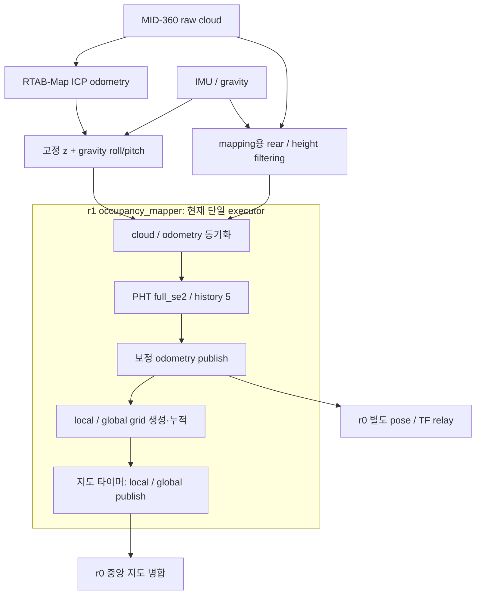

# 실험 4 — r1 mapper 발행 지연 진단 인계

- 작성일: 2026-10-22, Asia/Seoul.
- 목적: **r1 노트북의 Codex가 실제 실행 환경에서 지연 원인을 추가 진단하고, 지도 송신 분리 설계를 검토**하기 위한 인계 자료.
- 계측 기준 코드: `b76da2e` (`features/jeongeon/optimization`). 실제 r1의 Git SHA·빌드·실행 snapshot도 확인할 것.
- 이번 인계는 문서 추가다. 프로세스/executor 분리는 아직 구현하지 않았다. 문서만 pull할 때는 재빌드가 필요 없다.

## 1. 확인된 결론과 남은 질문

- **3.6Hz로 제한한 설정은 없다.** 앞서 관측한 3.6Hz는 계측 구독자의 수신율이다.
- 새 내부 계측에서 실제 mapper odometry 발행률은 **약 2.00Hz**였다.
- 가장 큰 대기는 **r1 local map `publish()` 호출 내부**에서 관측됐다.
- 같은 구간의 PHT·지도 계산 자체는 짧았다. 이 결과를 이동 중·다른 공간에도 일반화하지 않는다.
- 지도 타이머와 동기화된 센서 처리가 같은 executor에서 실행된다. 지도 발행이 오래 걸리면 입력 콜백 처리도 밀리는 구조다.
- 아직 **DDS 구현/전송 방식/송신 버퍼/원격 구독 부하/OS scheduling 중 무엇이 긴 발행 시간을 만드는지**는 확정하지 못했다. wall time은 CPU 계산시간과 다르다.
- 목표는 실제 새 pose의 갱신율 개선이다. 과거 pose를 현재 timestamp로 반복 발행해서 빠르게 보이게 만들지 않는다.

## 2. 유지할 파이프라인과 설정



- ICP 입력은 **raw cloud**, deskew OFF, ICP `topic_queue_size=1`을 유지한다.
- mapping 입력에는 rear filter와 높이 필터를 적용한다. z는 고정 높이, roll/pitch는 IMU gravity 기준이며 floor plane 추정에 의존하지 않는다.
- single-agent PHT `full_se2`, history 5 흐름을 유지한다. 진단을 위해 ICP/PHT 파라미터를 한꺼번에 바꾸지 않는다.
- 초기 agent 정합: 정지 상태 global snapshot 누적 최소 3초 → 전체 yaw 검색 → 품질 gate 통과 **1회** → 고정 변환.
- free-conflict gate는 기본 **18%**. 이후 global 구독 OFF / local 구독 ON으로 병합 지도를 확장한다.
- r0에는 pose/TF 전용 프로세스가 이미 있다. **이번 병목은 r1 producer 쪽**이므로 r0 relay 분리만으로 해결되지 않았다.
- `publish_period_ms: 200`은 **지도 타이머의 요청 주기 5Hz**다. 보정 odometry는 센서 동기화 콜백에서 PHT 보정 후 발행한다.

## 3. 이번 계측 근거

- r0 실행 기록: `outputs/experiment_04_multi_agent_mapping/runs/20261022_195451_568108/`.
- 원본 결과는 r0에만 있으며 Git에서 제외된다. **r1에는 아래 수치와 재현 절차를 전달**한다.
  - `outputs/experiment_04_multi_agent_mapping/diagnostics/mapper_instrumented_r1.json`
  - `outputs/experiment_04_multi_agent_mapping/diagnostics/mapper_instrumented_analysis.json`
  - `outputs/experiment_04_multi_agent_mapping/diagnostics/mapper_instrumented_delivery.json`
  - `outputs/experiment_04_multi_agent_mapping/diagnostics/mapper_instrumented_r0.json`
- r1 내부 진단 33건: 동일 `instance_id=4416405646304986`, report sequence 112→144.
- 원격 계측은 약 40초. 내부 진단 양 끝의 `uptime_sec`는 164.029686003→202.038433991로 **38.008748초**다.
- 아래 source 수치는 같은 instance의 양 끝 카운터 차이로 계산했다. remote 구독자 수신 수와 관측 구간이 정확히 같지는 않으므로 차이를 곧바로 손실률로 해석하지 않는다.

| r1 내부 카운터 | 38.008748초 동안 증가 | 초당 |
| --- | ---: | ---: |
| mapper cloud 입력 수신 | 76 | 2.00 |
| mapper odometry 입력 수신 | 76 | 2.00 |
| 동기화 콜백 | 76 | 2.00 |
| 정상 처리 완료 | 76 | 2.00 |
| 보정 odometry publish 호출 / 정상 반환 | 76 / 76 | 2.00 |
| local / global map publish 정상 반환 | 각각 57 | 각각 1.50 |
| tracking / alignment / TF / xyz skip | 각각 0 | 0 |

| 처리 구간 | 구간 내 횟수 | 구간 평균 wall time | 구간 누적 wall time |
| --- | ---: | ---: | ---: |
| 전체 센서 동기화 콜백 | 76 | 61.197ms | 4.651초 |
| PHT | 76 | 0.261ms | 0.0199초 |
| 보정 odometry `publish()` | 76 | 59.203ms | 4.499초 |
| local grid 생성 | 76 | 0.541ms | 0.0411초 |
| global grid 갱신 | 76 | 0.910ms | 0.0692초 |
| local map `publish()` | 57 | **540.818ms** | **30.827초** |
| global map `publish()` | 57 | 0.044ms | 0.0025초 |
| 지도 타이머 전체 | 57 | 540.862ms | 30.829초 |

- 평균 계산: `(마지막 mean_ms × 마지막 count − 처음 mean_ms × 처음 count) / count 증가량`.
- PHT ⊂ pose 보정 ⊂ 센서 콜백, local/global publish ⊂ 지도 타이머이므로 중첩 시간을 합산하지 않는다.
- **local map publish만 관측 구간의 약 81% wall time을 사용**했다. CPU가 그 비율로 사용됐다는 의미는 아니다.
- 마지막 진단의 최근 256개 표본 p95: PHT 1.538ms, odometry publish 422.275ms, local map publish 2026.325ms.
- 프로세스 전체 누적 최대: odometry publish 1279.121ms, local map publish 2432.061ms. 이 최대값을 위 38초 구간의 최대값으로 간주하지 않는다.
- 마지막 구독자 수: local map 1, global map 0, odometry 3. odometry 구독자는 계측 중 2→3으로 변했다. 각 구독자의 프로세스·호스트·QoS는 r1 현장에서 확인해야 한다.
- 실제 진단 발행 간격은 0.324~2.130초였다. 요청 주기 1초가 보장되지 않았고, 밀린 실행 후 짧은 구간에 콜백이 몰리는 현상도 있었다.
- 이 구간 입력 stamp 중복·역행 카운터는 0이었다. 프로세스 전체 sync stamp 차이는 평균 16.154ms / 최근 p95 99.908ms / 최대 600.028ms여서 timestamp 정합도 후속 확인 대상이다.

### 원격 수신 관측 — 별도 지표

- 약 40초 r0 관측: r1 raw odometry **9.78Hz**, fixed/gravity odometry **9.71Hz**, mapper 보정 odometry **1.72Hz**, aligned odometry **1.56Hz**.
- 별도 25초 계측의 동일 stamp 수신시각 차이 p95: r1 source topic→aligned topic **4.96ms**. 이는 관측자 scheduling을 포함하며 순수 relay/무선 지연과 같지 않다.
- r0 mapper의 별도 약 12초 진단: 입력·동기화·발행 약 6Hz, callback 최근 p95 약 14.66ms. r0/r1의 장비·입력률·송신 조건이 다르므로 대조 실험 결과로 취급하지 않는다.

## 4. 코드에서 확인할 위치

| 파일 / 함수 | 확인 내용 |
| --- | --- |
| `src/occupancy_mapper.cpp` | `rclcpp::spin(...)`: 현재 단일 executor |
| `include/co_3dto2d_mapping/occupancy_mapper_node.hpp` | 기존 message_filters 구독, 동기화, 지도 타이머; callback group 분리 지정 없음; 기존 지도/odom publisher depth 10 |
| `include/co_3dto2d_mapping/occupancy_mapper/sensor_and_local_grid.inc` / `sensorCallback()` | 동기화 후 PHT→보정 odom 발행→지도 갱신→debug 발행이 순차 실행 |
| `include/co_3dto2d_mapping/occupancy_mapper/global_grid.inc` / `publishMaps()` | local/global map 발행이 같은 타이머 안에서 순차 실행 |
| `include/co_3dto2d_mapping/occupancy_mapper/local_pht_submap_pose_graph.inc` | PHT 처리 범위와 계측 scope |
| `include/co_3dto2d_mapping/mapper_pipeline_metrics.hpp` | 고정 메모리 표본·입력 카운터·RAII wall timer |
| `include/co_3dto2d_mapping/occupancy_mapper/pipeline_metrics.inc` | 내부 카운터/시간/발행률/구독자 수 진단 |
| `config/experiment/experiment_04_multi_agent_mapping/robot1.yaml` | metrics ON / 1000ms, 지도 200ms, sync queue 100 |
| `co_3dto2d_mapping/multi_agent/mapping.py` / `set_subscriptions()` | r0는 lock 후 local 구독; 현재 local 구독의 QoS depth 10 / Reliable |
| `co_3dto2d_mapping/multi_agent/pose_relay.py` | r0 pose/TF 별도 프로세스, 원 stamp 보존 |
| `scripts/tools/monitor_pipeline.sh` / `.py` | source 진단과 구독자 관측을 함께 JSON으로 저장 |
| `docs/experiment_04_setup.md` §7 | 지표 정의와 실행 명령 |

- 내부 입력 count는 **기존 mapper 구독까지 전달된 메시지 수**다. sensor 발행 총수나 정확한 DDS drop 수는 아니다.
- `publish_returns`는 RMW 발행 API의 정상 반환 횟수다. 원격 delivery acknowledgement가 아니다.
- 진단 타이머도 mapper executor를 공유한다. 진단이 늦으면 `report_interval_sec`, sequence, receipt age를 함께 본다.
- 코드상의 QoS와 실노드 QoS·실제 RMW 구현이 같은지 현장에서 확인한다. DDS 내부 원인을 아직 특정하지 않았다.

## 5. r1 Codex가 먼저 확인할 내용

- **실행 환경**
  - Git SHA·실제 설치 binary·실행 config snapshot·build type/ROS 배포판.
  - 실행 중인 프로세스의 `ROS_DOMAIN_ID`, `ROS_LOCALHOST_ONLY`, RMW/DDS 환경·profile, 사용 NIC·라우팅.
  - 실제 RMW 구현과 버전. 환경변수가 비어 있으면 기본 구현을 별도로 확인한다.
  - CPU·스레드 scheduling·메모리 상태와 NIC 송수신/손실·무선 링크 상태.
- **발행/구독 경로**
  - local map의 width·height·resolution·data 크기·고유 stamp 갱신율·실발행률.
  - local/global map, corrected odom, path/debug cloud의 실제 publisher/subscriber QoS·수·소유 노드.
  - rqt/RViz/recorder 등 추가 원격 구독자가 있는지. 계측 구독자가 비교 조건을 바꾸는지도 기록한다.
  - odometry publish도 느린 이유가 지도 writer/participant와 공유하는 자원인지 확인한다.
- **보고 시 구분**
  - 입력 수신·동기화·처리 완료·발행 API 반환·원격 수신을 분리한다.
  - 최근 p95와 프로세스 전체 max, 구간 평균을 구분한다.
  - 비교 기간·instance·source stamp 범위를 맞추고 워밍업·초기 정합 전후를 분리한다.
  - 관측한 사실, 추가 가설, 아직 확인하지 않은 항목을 구분한다.

## 6. 분리 설계 검토안

- **우선 검토: 별도 지도 송신 프로세스**
  - mapper의 센서/PHT/pose 처리와 원격 지도 송신·시각화·저장을 분리한다.
  - mapper→송신기 경계는 짧게 최신 snapshot을 넘기는 구조로 검토한다. 이 경계에서 기존 Reliable 대기가 그대로 발생하면 분리 효과가 없다.
  - snapshot은 immutable하게 취급하고 공유 상태 lock을 짧게 유지한다. lock을 잡은 채 `publish()`하거나 파일을 저장하지 않는다.
  - 전송 queue 크기·덮어쓰기·누락 카운터를 명시하고 메모리/backlog가 무한히 증가하지 않게 한다.
  - 승인된 외부 토픽·frame·원 timestamp를 유지한다. local grid는 이미 `r1/odom`에 투영돼 있으므로 pose를 다시 곱하지 않는다.
  - corrected odometry 발행도 별도로 지연됐으므로 지도 송신만 옮긴 뒤 odom `publish()` 대기가 남는지 확인한다.
- **대안/중간 비교: 같은 프로세스의 별도 callback group + executor worker**
  - 센서/PHT의 상태 갱신은 직렬화하고, 지도 송신은 별도 callback group에서 immutable snapshot을 사용하도록 설계한다.
  - executor 스레드 수만 늘리고 callback group/공유 상태를 그대로 두는 방식으로 병목이 해소된다고 가정하지 않는다.
  - DDS 자원이나 메모리/lock을 공유하면 다른 writer 지연이 남을 수 있으므로 별도 프로세스 안과 비교한다.
- **지도 누락 대책**
  - 최신 local snapshot만 남기면 순간적으로만 보인 영역을 잃을 수 있다. 단순히 큐를 줄였다는 이유로 성공 판정하지 않는다.
  - sequence·epoch·원 stamp·버린 snapshot 수를 기록하고, 증거 누적/누락 복구 정책을 설계한다.
  - 현재 r0의 내부 queue overflow 시 global snapshot 복구는 **송신 전 누락이나 모든 DDS 손실을 검출하는 기능이 아니다**.
- **최적화는 한 조건씩 비교**
  - 현재 상태 baseline → 송신 경로 분리 → 필요할 때 지도 발행률/전송량/QoS 조건 비교.
  - 비교할 때 r0의 대응 구독 QoS도 맞춘다. 예를 들어 송신만 Best Effort로 바꾸고 기존 Reliable 구독을 유지하면 연결이 성립하지 않을 수 있다.
  - 처음부터 PHT history·추출 파라미터·ICP 설정까지 바꾸면 원인 비교가 어렵다.

## 7. 실행과 결과 저장

- r1 매핑 프로세스를 정상 종료한 뒤 코드 변경 시 빌드하고, 기존 r1 매핑 명령으로 시작한다. 기존 driver를 중복 실행하지 않는다.
- 사용자가 r0를 직접 실행 중이다. r1 진단 중 r0 운용 노드의 종료·재시작이 필요한 조건은 r0 담당자와 측정 시간을 맞춘다.
- 매핑이 정상 동작하는 동안 별도 터미널에서 계측한다.

```bash
cd ~/co-3dto2d-mapping
# 문서 확인만 한다면 pull까지만 수행
git pull --ff-only

# C++ 코드가 바뀐 경우, 매핑을 종료한 뒤 수행
source /opt/ros/humble/setup.bash
colcon build --packages-select co_3dto2d_mapping --symlink-install

# 기존 명령으로 r1 매핑을 시작한 뒤 별도 터미널에서 수행
bash scripts/tools/monitor_pipeline.sh --duration 60
```

```bash
# r0의 별도 터미널: r1 계측과 겹치도록 실행
bash scripts/tools/monitor_pipeline.sh --role receiver --duration 90
```

- `outputs/experiment_04_multi_agent_mapping/diagnostics/실행시각/`에 JSON을 저장한다. 내부 진단 토픽은 `/r1/mapping/pipeline_diagnostics`다.
- run별 Git SHA, config, 실제 publisher/subscriber 수, 환경, 계측 도구, warmup/lock 상태를 함께 기록한다. ROS clock과 wall clock을 혼동하지 않는다.
- 결과/rosbag/build/install은 Git에 올리지 않는다. 공유할 핵심 수치·결론·재현 명령은 MD에 정리한다.
- 참고 브랜치 `fix/direct-occupancy-icp-no-gates` (`36ad9ba`)는 읽기 전용이다. 현재 작업 브랜치와 섞거나 수정/push하지 않는다.

## 8. 진단/개선 결과의 판단 기준

- source 입력 대비 mapper 처리·실제 발행률이 얼마나 회복됐는지.
- local map / corrected odometry `publish()`의 평균·p95·최대와 대기 누적 비율이 줄었는지.
- 원격 aligned pose의 새 stamp 갱신율·수신 공백·age가 개선됐는지.
- queue·메모리·지연이 시간에 따라 계속 증가하지 않는지.
- 지도 누락·이중 벽·초기 정합·session reset·종료 저장이 악화되지 않는지.
- 한 번의 정지 관측으로 일반화하지 않고 이동 시퀀스에서도 같은 지표와 지도 품질을 확인한다.

## 9. r1 Codex에 전달할 요청

> 이 문서를 읽고 r1 실환경에서 mapper의 긴 local-map/odometry 발행 시간을 진단해 주세요. 현재 실행 config·binary·RMW·구독자·지도 크기·CPU/네트워크 상태를 확인하고, 계측 근거에 따라 원인 후보를 좁혀 주세요. r1 producer의 지도 송신 분리를 우선 설계하되, 프로세스 간 전달 경계의 대기와 지도 누락 대책까지 검토해 주세요. 기존 ICP/PHT와 초기 정합 흐름을 유지하고, 확인한 사실·가설·개선 전후 수치를 구분해 보고해 주세요.
