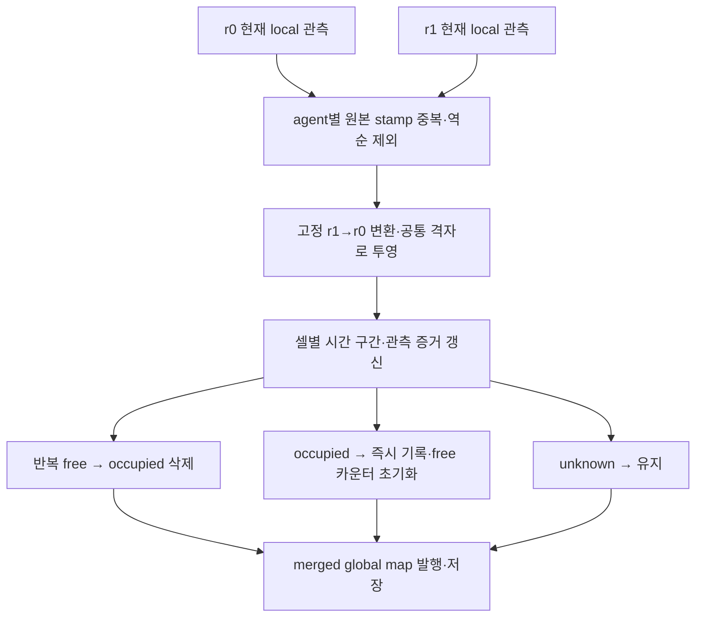

# 실험 4 — 중앙에서 동적 객체 흔적 갱신

## 적용 범위

- r0 중앙이 r0/r1의 새로운 local occupied/free 관측으로 **하나의 공통 시간 증거 지도**를 갱신한다.
- 개별 agent의 오래된 occupied layer를 다시 합쳐 흔적을 되살리지 않는다. `r1/aligned_global_occupancy`는 r1 관측만의 비교 지도이며 merged map의 최종 재병합 입력이 아니다.
- 초기 global snapshot은 bootstrap용이다. queue 초과 후 global resync도 live 관측한 셀은 덮어쓰지 않고 증거 카운터를 증가시키지 않는다.
- ICP raw 입력, deskew OFF, queue 1, 고정 z/gravity, PHT full_se2/history 5, rear/height 전처리, 초기 정합과 pose/TF 전용 프로세스는 유지한다.
- single-agent `dynamic_filter_enabled`는 현재 OFF로 유지한다. 중앙 처리와 독립적이며 중앙 입력 local grid는 현재 관측이다. 현재 보이는 사람의 점을 분류/제거하는 기능이 아니라 이동 후 free로 재관측된 흔적을 지운다.



## 설정

기존 실행 명령의 `--alignment-config`가 지정하는 YAML에서 관리한다. 기본은
`config/experiments/experiment_04_multi_agent_mapping/alignment.yaml`이다.
14%/18% 정합 gate 비교 YAML에도 같은 기본값을 반영했다. 변경 후 중앙을 재시작한다.

```yaml
/**:
  ros__parameters:
    merged_dynamic_filter_enabled: true
    merged_dynamic_free_clear_count: 30
    merged_dynamic_evidence_timeout_sec: 5.0
    merged_dynamic_observation_bin_sec: 0.1
    merged_dynamic_clear_max_range_m: 6.0
```

| 설정 | 의미 |
| --- | --- |
| `merged_dynamic_filter_enabled` | true: 중앙 temporal 갱신. false: 기존 occupied 우선 누적 |
| `merged_dynamic_free_clear_count` | occupied 삭제에 필요한 서로 다른 시간 구간의 free 관측 수 |
| `merged_dynamic_evidence_timeout_sec` | 마지막 유효 관측과의 공백 초과 시 카운터만 초기화. 0은 timeout 비활성화 |
| `merged_dynamic_observation_bin_sec` | 원본 시각을 나누는 구간 폭. 기본 0.1초에서 셀당 최대 free 10회/초 |
| `merged_dynamic_clear_max_range_m` | 이미 occupied인 셀은 관측 agent 센서로부터 이 거리 안의 free만 삭제 증거로 사용. 0은 거리 제한 없음 |

- free 30회는 고정 3초를 뜻하지 않는다. 새 local 관측이 느리거나 해당 셀이 가려지면 더 오래 걸린다. 같은 bin이더라도 서로 다른 셀의 증거는 독립적이다.
- free ray 확장/dilation은 적용하지 않는다. occupied 투영은 기존의 보수적 면적 rasterization을 유지한다.
- 거리 제한의 센서 위치는 현재 `buildLocalGrid()` 규약대로 local map 사각형의 중심에서 구한다. r1은 같은 고정 변환을 적용한다. 다른 producer가 비중심 local map을 보내면 별도 sensor origin 정보가 필요하다.

## 관측 시각과 충돌 규칙

1. agent ID별 원본 local map stamp가 같거나 뒤로 가면 프레임 전체를 제외한다. 이 검사는 ROS callback과 fusion core 양쪽에 있다.
2. worker의 한 batch는 source stamp/agent ID로 정렬한다. PC 시계를 동기화해야 하며 수신 시각으로 restamp하지 않는다.
3. 셀별로 마지막 관측 시각, 현재 시간 구간의 occupied 여부, free 카운터를 보관한다. unknown은 이 시각도 갱신하지 않는다.
4. 시간 구간은 `source_stamp_ns // bin_ns`다. 두 agent의 같은 구간 free는 한 번만 센다. 같은 구간에서 어느 agent든 occupied를 관측하면 occupied를 유지하고 free 카운터를 0으로 한다.
5. 셀의 최신 구간보다 오래된 구간의 관측은 제외한다. **동일 구간은 동시 관측으로 취급**하므로 그 안의 약간 더 오래된 occupied도 충돌 증거로 반영한다. 셀의 마지막 원본 시각은 최댓값을 유지한다. 이는 occupied 우선을 구간 내에서 일관되게 적용하기 위한 예외다.
6. 한 agent가 다른 방을 탐색하면 그 agent만의 새 free도 해당 방 셀을 삭제할 수 있다. 다른 agent의 과거 지도를 재병합하지 않는다.
7. 5초 공백은 셀의 TTL이 아니다. 미관측 occupied는 유지하고 다음 유효 관측 시 오래된 free streak만 초기화한다.
8. session 변경/clock reset/명시적 정합 reset이면 지도·시간 증거를 새 generation으로 초기화한다.

- 서로 다른 구간 사이의 큰 통신 지연은 최신 증거 우선으로 제외되므로 삭제 지연에 영향을 줄 수 있다. 재정렬 대기 buffer나 완전한 전송 보장 기능은 추가하지 않았다.
- 같은 구간의 free가 먼저 삭제 기준을 충족하고 occupied가 나중에 오면 즉시 occupied로 복구한다. 아직 도착하지 않은 미래 메시지까지 기다렸다가 확정하는 방식은 아니다.
- PC 간 source clock 오차는 잘못된 오래된 관측 판정이나 구간 분리를 일으킬 수 있다. 실제 취득 전에 양쪽 시스템 시각과 장치 stamp 기준을 확인한다.

## 실행과 상태 확인

- 중앙 기능 변경이므로 기존 명령을 사용한다. r1의 local-map 형식은 그대로여서 이 기능만을 위해 r1 매핑을 재시작할 필요는 없다.
- r0의 설치본에 새 Python 모듈·YAML을 반영하려면 다음과 같이 빌드/source한다. 실행 중인 사용자 매핑은 자동 종료하지 않는다.

```bash
cd ~/co-3dto2d-mapping
source /opt/ros/humble/setup.bash
colcon build --packages-select co_3dto2d_mapping --symlink-install --cmake-args -DBUILD_TESTING=OFF
source install/local_setup.bash
# 이후 기존 r0 실행 명령 사용
```

- 시작 로그 `Central temporal occupancy: enabled=True ...`와 삭제 발생 시 `cleared=... cells (... total)`를 출력한다.
- 기존 실행기 상태 출력에도 중앙 필터 ON/OFF, 삭제 누적 셀 수와 과거 관측 제외 셀 수를 표시한다.
- `/multi_agent/alignment_status`에 `temporal_filter_config`, `temporal_fusion`을 추가한다. 기존 topic 이름은 바꾸지 않는다.
- `temporal_fusion.common`은 누적 셀 관측 수이며 프레임 수가 아니다: `cleared_cells`, `free_votes`, `stale_cell_observations`, `same_bin_cell_observations`, `same_bin_free_suppressed`, `timeout_counter_resets`, `range_blocked_free_cells` 등.
- `temporal_fusion.input_counts`는 core의 agent별 채택/중복·과거 프레임 수다. callback에서 먼저 제외한 수는 기존 `local_input_stats`에서 확인한다.
- `effective_central_config.json`, `save_status.json`, `checkpoint_status.json`에 설정·정책·증거 통계를 저장한다. 최종 map PNG/PGM/NPZ 저장 경로는 유지한다.

## 비교 시 확인할 사항

- 중앙 OFF/ON 비교는 동일 local 관측·동일 inter-agent transform으로 수행해야 한다. raw ICP부터 다시 돌리면 경로 차이가 섞일 수 있다.
- 현재 r0 recorder 기본 filtered cloud/고정 pose capture로 추후 mapping-only replay를 구성할 수 있지만, 기존 raw replay 실행기가 이를 자동 지원하는 것은 아니다.
- 중앙 입력을 그대로 보존하려면 recorder의 `--with-agent-maps`를 사용한다. 원격 지도 구독량이 늘어난다.
- 벽/얇은 가구의 손실, 사람 흔적 제거 지연·잔존 면적, 중앙 `merge_runtime_ms`, queue 누락을 함께 확인한다.
- 이번 구현 단계에서는 실센서 실행·bag 재생·동작 테스트를 수행하지 않았다. 실제 제거 효과와 처리율은 취득 후 확인한다.
