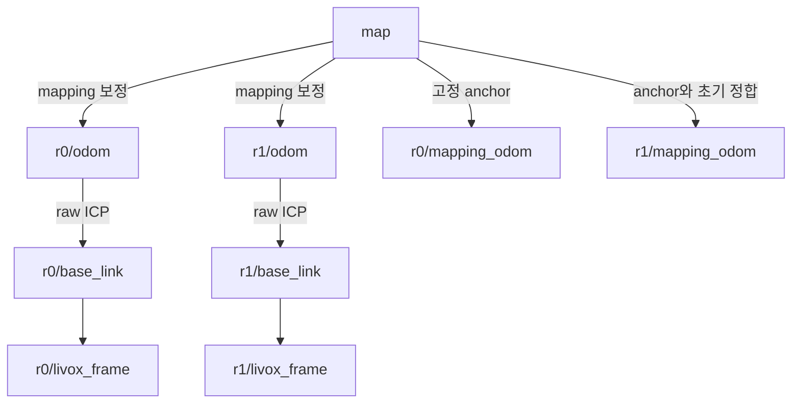

# 실험 4 — 고정 map 좌표계와 전역 pose 인터페이스

## 이번 변경 범위

- 공통 world frame은 기본 `map`
  - 최초 중앙이 수신한 r0 mapping pose의 **XY 위치·yaw**로 기준을 잡고 고정함
  - 초기 정지 관측 중 중앙을 시작해야 의도한 시작 위치가 기준이 됨
- z=0은 기존 고정 높이 방식의 바닥 기준
  - 따라서 r0 초기 전역 pose의 XY/yaw는 0이고 base z는 설정된 높이(기본 0.30m)
- 운영 기본값: **초기 정합만 수행** · `central.periodic.enabled: false`
  - 주기적 정합·원본 관측 재투영은 선택 기능
  - 동작·설정·한계: [주기 정합·재투영](experiment_04_periodic_alignment.md)
- ICP 입력·deskew·queue·PHT·height/rear·중앙 temporal filter 정책은 유지
- 단순 frame_id 교체가 아님
  - 지도 셀·경로·pose에 같은 고정 world 변환을 적용하고 raw odom TF와 mapping 보정 좌표계를 분리

## Frame 역할과 TF 소유자

| Frame | 역할 / 발행 주체 |
| --- | --- |
| `map` | 공통 world<br>최초 r0 XY/yaw 기준 |
| `rN/odom → rN/base_link` | 기존 RTAB-Map raw ICP odometry<br>기존 노드가 TF를 계속 소유 |
| `rN/mapping_odom` | 고정 높이/gravity/PHT 보정 지도·pose의 내부 기준<br>raw odom과 혼용하지 않음 |
| `map → rN/mapping_odom` | 최초 world anchor + 초기 agent 정합<br>중앙 relay가 발행 |
| `map → rN/odom` | mapping 보정 전역 pose와 같은 시각의 raw TF로 계산<br>중앙 relay가 단독 소유 |
| `map → rN/mapping_base_link` | 기존 디버그 frame 호환용 전역 pose 별칭<br>실제 base_link와 같은 시각의 같은 pose |



- PHT 보정은 내부 mapping pose에 존재하고, 해당 pose와 raw pose의 차이를 `map→odom`에 반영함
  - raw `odom→base_link`에 전역 보정을 다시 넣지 않음
- `T_map_odom(t) = T_map_base_corrected(t) × inverse(T_odom_base_raw(t))`
  - z/roll/pitch도 포함하는 SE(3) 계산
- raw TF를 **mapping cloud의 원본 timestamp**에서 lookup함
  - 내부에 최대 32개·기본 1초의 짧은 pose 정렬 buffer를 두고, TF가 준비된 가장 최신 pose만 발행함
  - TF가 pose보다 지속적으로 늦어도 발행이 영구 대기하지 않게 하며, 오래된 pose를 밀린 순서대로 재생하지 않음
  - lookup 실패를 최신 TF나 identity로 대체하지 않음
- `map→odom`과 전역 pose는 같은 source timestamp로 발행함
  - 과거 보정을 현재 시각으로 restamp하지 않으므로 Nav2/회사 측 TF 허용 지연은 실제 mapping 출력 지연과 맞춰야 함
- raw ICP 자체의 tracking 실패·pose jump를 이 변경으로 제거하는 것은 아님
- 기존 `r0/odom→r1/odom` 중앙 TF는 발행하지 않음
  - 다른 localization 노드가 `map→rN/odom`을 동시에 발행하면 안 됨

## 공개 토픽

| 토픽 | 타입 / 기준 |
| --- | --- |
| `/multi_agent/r0/global_pose`, `/multi_agent/r1/global_pose` | `geometry_msgs/PoseWithCovarianceStamped`, header.frame_id=`map` |
| `/multi_agent/rN/aligned_odometry` | `nav_msgs/Odometry`, header.frame_id=`map`, child_frame_id=`rN/base_link`<br>기존 이름 유지 |
| `/multi_agent/rN/aligned_path` | `nav_msgs/Path`, `map` |
| `/multi_agent/merged_global_occupancy` | `nav_msgs/OccupancyGrid`, `map` |
| `/multi_agent/r1/aligned_global_occupancy` | `map` 기준 r1 관측 누적 비교 지도 |
| `/multi_agent/map_anchor` | latched TransformStamped, `map ← r0/mapping_odom` |
| `/multi_agent/r1_to_r0_transform` | 기존 토픽명 유지<br>`r0/mapping_odom ← r1/mapping_odom` 초기 정합 |
| `/multi_agent/map_status` | latched DiagnosticArray: world_frame, coordinate_epoch, revision, ready 등 |

- `/rN/mapping/floor_based_odometry`, `/rN/mapping/occupancy_mapper_odometry`, local/global occupancy, 투영 debug cloud는 이제 `rN/mapping_odom` 기준
  - raw `/rN/odom`만 기존 `rN/odom` 기준을 유지
  - multi-agent 실행기가 robot ID별 mapping frame을 구성해 launch에 전달
- covariance는 기존 추정값을 좌표 변환한 것으로, 새로 검증된 전역 위치 정확도를 의미하지 않음
  - aligned_odometry의 twist는 기존 body-frame 속도 추정이며 보정 pose의 시간 미분으로 재추정하지 않음
  - 전역 위치 연동에는 global_pose를 권장
- raw_path는 최초 world 기준에서 본 **보정 전 비교 궤적**
  - 현재 map→odom 보정을 적용한 실제 전역 pose와 구분

## 설정·업데이트

- `config/multi_agent.yaml`의 `central`: `world_frame: map`, `pose_relay_pose_timeout_sec: 2.0`, `pose_relay_tf_wait_timeout_sec: 1.0`
- robot별 최종 설정: 실행기가 `global_frame_id: rN/mapping_odom`, `use_odom_header_frame: false`를 구성
  - 실행 snapshot의 최종 YAML에서 확인
- **두 PC 모두 pull·build·source 후 기존 명령으로 다시 시작** 필요
  - 구버전 r1의 `r1/odom` mapping 출력과 신버전 중앙을 섞으면 입력을 거절하며 pose relay가 예상 frame 오류를 기록
- RViz 기본 Fixed/Target Frame은 `map`
  - 현재 실행 중인 사용자의 프로세스를 이번 변경에서 자동 재시작하지 않음

```bash
git pull --ff-only
source /opt/ros/humble/setup.bash
colcon build --packages-select co_3dto2d_mapping --symlink-install --cmake-args -DBUILD_TESTING=OFF
source install/local_setup.bash
# 각 PC에서 기존 실험4 실행 명령 사용
```

## 회사 측 goal·exploration 연동

- goal/global path는 `map`으로 저장·전달하고 global_pose도 같은 `map`에서 사용
  - map origin의 기준은 로봇 이동이나 PHT 보정에 따라 변경하지 않음
- 지도 출력마다 `map_status.revision`이 증가함
  - 이는 동적 free 갱신 등 일반 지도 갱신도 포함하며 loop closure 횟수가 아님
- `map_status.map_source_stamp_ns`와 수신 OccupancyGrid의 header stamp로 상태와 지도 snapshot을 연결함
  - 서로 다른 ROS 토픽의 도착 순서가 원자적으로 보장되는 것은 아님
- `coordinate_epoch = central_instance:generation`은 reset/session 경계 표시
  - 값이 바뀌면 이전 goal/path를 무조건 그대로 재사용하지 않고 회사 측에서 유효성을 확인
- r1 재시작·명시적 alignment reset은 r0 world anchor를 유지
  - r0 session/clock reset이나 중앙 재시작은 원 좌표계의 연속성을 보장할 수 없어 새 epoch/anchor를 생성
  - 실행 간 동일 절대 좌표계를 유지하려면 저장 지도 localization 또는 외부 기준이 별도로 필요
- `map_status.ready`: 지도 입력·정합 상태
  - 전역 pose 수신 여부는 pose_relay_status의 `global_pose_fresh`, source timestamp, `raw_tf_wait_count`도 확인
  - 일치하는 raw TF가 없으면 pose를 발행하지 않음
- goal 유효성 검사·경로 재계획·frontier 재선택은 회사 exploration 시스템의 역할
  - 본 저장소는 해당 시스템의 goal을 자동 수정하지 않음
- 주기적 정합 사용 시: 원본 관측을 새 변환으로 재투영한 뒤 변환·지도를 함께 확정
  - 재투영 실패·예산 초과 시 기존 변환·지도 유지
  - `alignment_revision`으로 보정 이력 구분 · 고정 map anchor/coordinate epoch 유지
  - TF만 바꾸고 기존 누적 격자를 그대로 두는 방식은 사용하지 않음

## 저장 지도 좌표

- 정상 종료와 `/multi_agent/save_map` 서비스는 기존처럼 PNG/PGM/YAML/NPZ를 저장
  - merged map 및 중앙의 agent layer는 모두 `map` 기준
- YAML의 `origin`: **이미지 좌하단의 map 좌표**
  - map 기준 원점과 같은 뜻이 아니며 음수도 정상
  - NPZ/YAML의 frame은 map이고 anchor/epoch/revision은 save_status.json에 저장됨
- 일반 지도 서버가 YAML의 비표준 frame_id 항목을 읽는다고 가정하지 않음
  - 회사 map server 자체의 frame 설정도 `map`으로 맞춰야 함
- 탐사 완료 자동 이벤트 구독은 추가하지 않음
  - 회사 측 완료 callback에서 기존 `/multi_agent/save_map` 서비스를 호출 가능
- 녹화 기본 profile에 map_anchor/map_status를 추가
  - 기존 raw replay 실행기는 새 설정으로 raw부터 계산
  - filtered cloud+pose는 mapper 후처리용
  - local grid 포함 bag은 [중앙 입력 재생](experiment_04_periodic_alignment.md) 경로 사용 가능
- 이전 결과 bag을 단순 재생하면 `map` TF가 없을 수 있음
  - 그때는 당시 RViz 설정/기준 프레임(`r0/odom`)으로 확인하거나 raw 입력을 새 파이프라인으로 재처리 필요
  - 과거 메시지의 frame_id만 바꿔 새 인터페이스로 간주하지 않음

## 확인 범위

- 코드의 frame/transform 경로, Python·YAML·RViz 구문과 패키지 빌드를 확인
- 이번 변경에서 실센서 재시작, bag 재생, 자동 동작 테스트는 수행하지 않음
  - 실제 TF 도착률·지연과 두 PC frame 일치는 다음 실행에서 확인 필요
